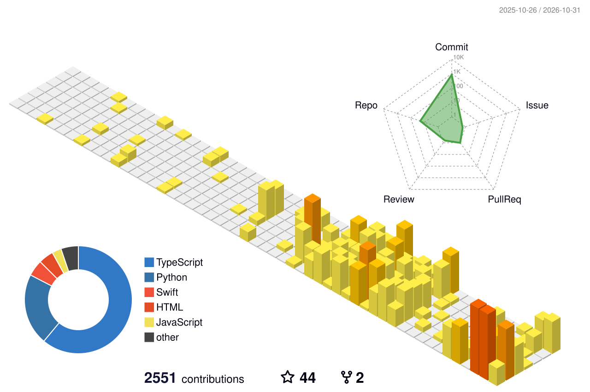

<picture><source media="(prefers-color-scheme: dark)" srcset="assets/hero-dark.svg?v=2"></picture>

  <a href="https://ojasvamishra.me"><b>ojasvamishra.me</b></a>&nbsp;&nbsp;&nbsp;·&nbsp;&nbsp;&nbsp;<a href="https://linkedin.com/in/ojasvamishra"><b>LinkedIn</b></a>&nbsp;&nbsp;&nbsp;·&nbsp;&nbsp;&nbsp;<a href="https://github.com/OjasMishra32/applytwin"><b>ApplyTwin</b></a>

 

## Now

<picture><source media="(prefers-color-scheme: dark)" srcset="assets/now-dark.svg?v=2"></picture>

<picture><source media="(prefers-color-scheme: dark)" srcset="assets/numbers-dark.svg?v=2"></picture>

 

## Projects

<a href="https://github.com/OjasMishra32/applytwin"><picture><source media="(prefers-color-scheme: dark)" srcset="assets/applytwin-dark.svg?v=2"></picture></a>

<a href="https://github.com/OjasMishra32/computervision_quant_strategy"><picture><source media="(prefers-color-scheme: dark)" srcset="assets/courtside-dark.svg?v=2"></picture></a>

<a href="https://github.com/OjasMishra32/Deja-View"><picture><source media="(prefers-color-scheme: dark)" srcset="assets/dejaview-dark.svg?v=2"></picture></a>

<table>
<tr><td width="190"><a href="https://github.com/OjasMishra32/fuse"><b>FUSE</b></a></td><td>Native iOS app for Bitrig Hacks (Y Combinator). Fold the iPhone Duo to fuse both screens into one AI result.</td></tr>
<tr><td width="190"><a href="https://github.com/OjasMishra32/eyesight"><b>Eyesight</b></a></td><td>LiDAR plus on-device CoreML obstacle detection on iPhone.</td></tr>
<tr><td width="190"><a href="https://github.com/OjasMishra32/Preventa"><b>PreventaAI</b></a></td><td>iOS app on the App Store, rated 5.0. SwiftUI and Firebase.</td></tr>
<tr><td width="190"><a href="https://github.com/OjasMishra32/twinly-api-examples"><b>Twinly API examples</b></a></td><td>iMessage bots, calls in your voice, voice notes, and tasks on the Twinly API.</td></tr>
</table>

 

## Research

First author on three robot control papers with Prof. Min Xu and Dr. Xiaolong Wu at Carnegie Mellon, validated on a Franka Emika Panda.

<table>
<tr><td width="110"><b>IEEE T-RO</b></td><td><a href="https://arxiv.org/abs/2601.18639v3">Constraint-Aware Discrete-Time PID Gain Optimization for Robotic Joint Control Under Actuator Saturation</a></td></tr>
<tr><td width="110"><b>ICRA 2027</b></td><td><a href="https://drive.google.com/file/d/1RI-l036hcbN7q3P3Y6LXI9N9ho1Zr-AK/view?usp=share_link">Bounding Detector-Accepted Feedback Authority in Torque-Limited Robot Control</a></td></tr>
<tr><td width="110"><b>IROS 2026</b></td><td><a href="https://drive.google.com/file/d/1COkJVmCta2tpfIe8U3wy_0fB3YzXXIv5/view?usp=sharing">SCIG++: Risk-Limiting Conformal Safety Filtering for Attack-Resilient Robotic Joint Control Under Saturation</a></td></tr>
<tr><td width="110"><b>SSRN</b></td><td><a href="https://papers.ssrn.com/sol3/papers.cfm?abstract_id=5408322">Introduction to Robotics and Programming</a>, a 120-page open-access textbook</td></tr>
</table>

 

## Experience

<table>
<tr><td width="250"><b>Northrop Grumman</b> Software Engineer</td><td>Current role.</td></tr>
<tr><td width="250"><b>Drift</b> (Antler) Founding AI/software engineer</td><td>Core infrastructure for a robotics AI coding workspace with 1,000+ users across ROS2, Gazebo, MuJoCo, and Isaac Sim. Shipped photo-to-3D scenes and a 129-robot catalog; traced a production Gazebo freeze to gz-transport multicast and fixed it.</td></tr>
<tr><td width="250"><b>CMU Xu Lab</b> Research intern</td><td>Actuator-aware control, conformal safety filtering, and secure feedback control. Multimodal SLAM and constrained control from perception to actuation.</td></tr>
<tr><td width="250"><b>Twinly</b> Co-founder and CEO</td><td>Digital clones of how you write, talk, and use a computer. macOS, Windows, and iOS apps with 1,000+ active users, including paying customers. Z Fellows cohort.</td></tr>
<tr><td width="250"><b>AlgoGators</b> Quant research analyst</td><td>1 of 2 first-years on the quant team of a ~$500K AUM student fund. Crack spread strategy with a 64% win rate across live trades.</td></tr>
<tr><td width="250"><b>EV Bots</b> AI robotics intern</td><td>Built the first working autonomous EV-charging robot prototype. The work went into multiple provisional patents.</td></tr>
<tr><td width="250"><b>PteroLabs</b> UAV simulation intern</td><td>Unreal Engine 5 UAV simulator with PX4, ArduPilot, and Betaflight SITL, used by UPenn for research.</td></tr>
<tr><td width="250"><b>iPipeline</b> Software intern</td><td>Test frameworks, AI agents, and developer tooling adopted across engineering teams.</td></tr>
</table>

 

## Recognition

- **Z Fellows**, 10-builder cohort &nbsp;·&nbsp; **YC Startup School** 2026
- **1st place**, YC Transpose (HIVE)
- **1st AI/ML** and **1st DeepSpace**, SwampHacks XII (Déjà View)
- **2nd of 200+**, Startup in a Weekend Philly (GlassBoxAI)
- **VEX Worlds** 3x &nbsp;·&nbsp; **TSA national finalist** 2x

 

## Stack

<picture><source media="(prefers-color-scheme: dark)" srcset="https://skillicons.dev/icons?i=py%2Ccpp%2Crust%2Cswift%2Cts%2Ccs%2Cjava%2Creact&theme=dark&perline=8"></picture>
 
<picture><source media="(prefers-color-scheme: dark)" srcset="https://skillicons.dev/icons?i=nextjs%2Ctauri%2Cpytorch%2Copencv%2Cros%2Cunity%2Cdocker%2Caws&theme=dark&perline=8"></picture>

 

## Contributions

<picture><source media="(prefers-color-scheme: dark)" srcset="profile-3d-contrib/profile-night-rainbow.svg"></picture>

Cards are generated by <a href="scripts/build.py">scripts/build.py</a> and refreshed daily by a GitHub Action.

