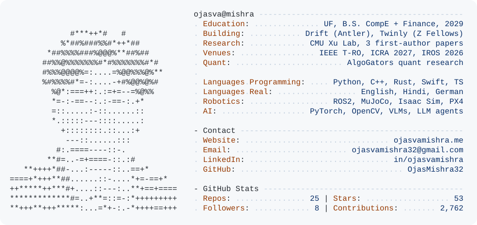
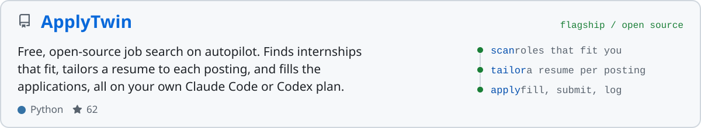
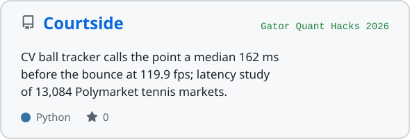
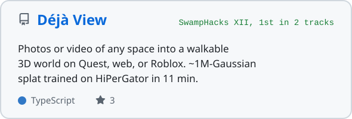
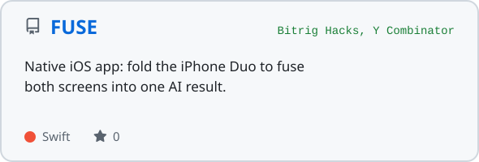
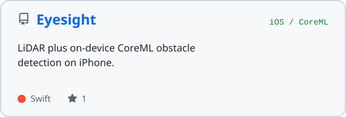
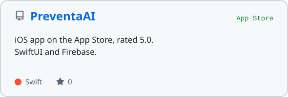
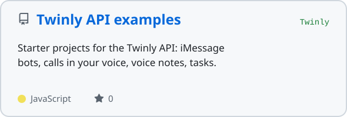

<picture><source media="(prefers-color-scheme: dark)" srcset="assets/header-dark.svg"></picture>

<a href="https://ojasvamishra.me">ojasvamishra.me</a>&nbsp;&nbsp;/&nbsp;&nbsp;<a href="https://linkedin.com/in/ojasvamishra">LinkedIn</a>&nbsp;&nbsp;/&nbsp;&nbsp;<a href="https://github.com/OjasMishra32/applytwin">ApplyTwin</a>

I build software for robots and for markets. Right now that means a founding role at [Drift](https://godrift.ai/) (a robotics AI coding workspace, backed by Antler), first-author control research at CMU's Xu Lab, running [Twinly](https://twinly.tech/), and quant research at AlgoGators. Sophomore at UF, Z Fellow.

<picture><source media="(prefers-color-scheme: dark)" srcset="assets/about-dark.svg"></picture>

### Open source

<a href="https://github.com/OjasMishra32/applytwin"><picture><source media="(prefers-color-scheme: dark)" srcset="assets/card-applytwin-dark.svg"></picture></a>

<a href="https://github.com/OjasMishra32/computervision_quant_strategy"><picture><source media="(prefers-color-scheme: dark)" srcset="assets/card-computervision_quant_strategy-dark.svg"></picture></a>
<a href="https://github.com/OjasMishra32/Deja-View"><picture><source media="(prefers-color-scheme: dark)" srcset="assets/card-deja-view-dark.svg"></picture></a>
<a href="https://github.com/OjasMishra32/fuse"><picture><source media="(prefers-color-scheme: dark)" srcset="assets/card-fuse-dark.svg"></picture></a>
<a href="https://github.com/OjasMishra32/eyesight"><picture><source media="(prefers-color-scheme: dark)" srcset="assets/card-eyesight-dark.svg"></picture></a>
<a href="https://github.com/OjasMishra32/Preventa"><picture><source media="(prefers-color-scheme: dark)" srcset="assets/card-preventa-dark.svg"></picture></a>
<a href="https://github.com/OjasMishra32/twinly-api-examples"><picture><source media="(prefers-color-scheme: dark)" srcset="assets/card-twinly-api-examples-dark.svg"></picture></a>

### Research

First author, with Prof. Min Xu and Dr. Xiaolong Wu at Carnegie Mellon. Validated on a Franka Emika Panda.

| Venue | Paper |
| :-- | :-- |
| **IEEE T-RO** | [Constraint-Aware Discrete-Time PID Gain Optimization for Robotic Joint Control Under Actuator Saturation](https://arxiv.org/abs/2601.18639v3) |
| **ICRA 2027** | [Bounding Detector-Accepted Feedback Authority in Torque-Limited Robot Control](https://drive.google.com/file/d/1RI-l036hcbN7q3P3Y6LXI9N9ho1Zr-AK/view?usp=share_link) |
| **IROS 2026** | [SCIG++: Risk-Limiting Conformal Safety Filtering for Attack-Resilient Robotic Joint Control Under Saturation](https://drive.google.com/file/d/1COkJVmCta2tpfIe8U3wy_0fB3YzXXIv5/view?usp=sharing) |
| **SSRN** | [Introduction to Robotics and Programming](https://papers.ssrn.com/sol3/papers.cfm?abstract_id=5408322), a 120-page open-access textbook |

### Work

| | | |
| :-- | :-- | :-- |
| **Drift** | Founding AI/software engineer | Infra for a robotics coding workspace with 1,000+ users across ROS2, Gazebo, MuJoCo, Isaac Sim. Photo-to-3D scenes, a 129-robot catalog, and a fix for a production Gazebo freeze traced to gz-transport multicast. |
| **CMU Xu Lab** | Research intern | Actuator-aware control, conformal safety filtering, secure feedback control. SLAM and constrained control from perception to actuation. |
| **Twinly** | Co-founder, CEO | Digital clones of how you write, talk, and use a computer. macOS, Windows, and iOS apps with 1,000+ active users, including paying customers. |
| **AlgoGators** | Quant research analyst | 1 of 2 first-years on the quant team of a ~$500K AUM student fund. Crack spread strategy at a 64% win rate across live trades. |
| **EV Bots** | AI robotics intern | Built the first working autonomous EV-charging robot prototype. Work went into multiple provisional patents. |
| **PteroLabs** | UAV simulation intern | Unreal Engine 5 UAV simulator with PX4, ArduPilot, and Betaflight SITL, used by UPenn for research. |
| **iPipeline** | Software intern | Test frameworks, AI agents, and developer tooling adopted across engineering teams. |

### Wins

Z Fellows (10-builder cohort) &nbsp;/&nbsp; YC Startup School 2026 &nbsp;/&nbsp; 1st, YC Transpose (HIVE) &nbsp;/&nbsp; 1st AI/ML and 1st DeepSpace, SwampHacks XII &nbsp;/&nbsp; 2nd of 200+, Startup in a Weekend Philly &nbsp;/&nbsp; VEX Worlds, 3x &nbsp;/&nbsp; TSA national finalist, 2x

### Stack

<picture><source media="(prefers-color-scheme: dark)" srcset="https://skillicons.dev/icons?i=py,cpp,rust,swift,ts,js,cs,java,react,nextjs,nodejs,tauri&theme=dark&perline=12"></picture>
 
<picture><source media="(prefers-color-scheme: dark)" srcset="https://skillicons.dev/icons?i=pytorch,opencv,ros,unity,blender,docker,aws,gcp,linux,postgres,supabase,firebase&theme=dark&perline=12"></picture>

### Activity

<picture><source media="(prefers-color-scheme: dark)" srcset="https://raw.githubusercontent.com/OjasMishra32/OjasMishra32/output/snake-dark.svg"></picture>

<picture><source media="(prefers-color-scheme: dark)" srcset="https://streak-stats.demolab.com/?user=OjasMishra32&hide_border=true&card_width=600&date_format=M%20j%5B%2C%20Y%5D&background=0D1117&stroke=30363D&ring=58A6FF&fire=3FB950&currStreakNum=E6EDF3&sideNums=E6EDF3&currStreakLabel=58A6FF&sideLabels=8B949E&dates=8B949E"></picture>

Cards in this README are generated by <a href="scripts/build.py">scripts/build.py</a> and refreshed daily by a GitHub Action.

